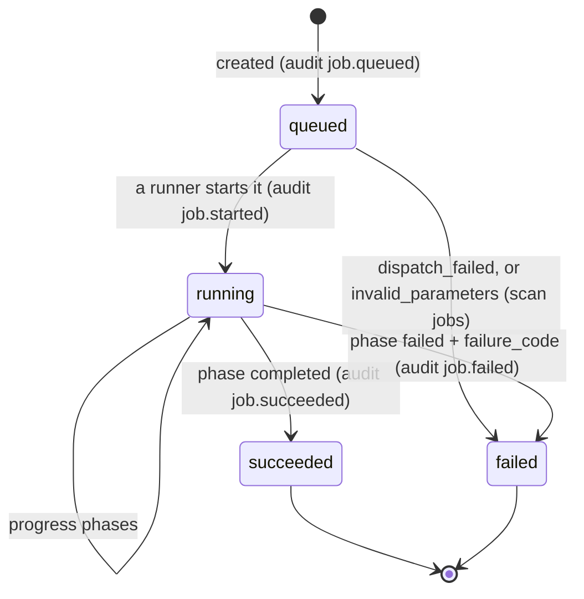

# Job guide

This guide is for developers changing or debugging asynchronous jobs. It covers
what every job shares: the job record, how jobs are sent to workers and run, and
how failures are recorded. It then describes annotation scan jobs, which are term
replacement and QC report jobs. The [refresh infrastructure
guide](refresh-infrastructure.md) covers what is specific to refresh jobs.

## The job record

Every job is a row of the `job` table. Its `job_type` says what it does, its
`parameters` say what it covers, and its `status`, `progress`, `result`, and
`error` say how it went. Each state change writes a `job.queued`, `job.started`,
`job.succeeded`, or `job.failed` audit event in the same transaction.
`GET /admin/jobs/{job_id}` returns any job.

A failed job's progress is `{"phase": "failed", "failure_code": ...}`, plus
`failure_details` for some refresh failures. `JobFailureCode` in `domain/jobs.py`
lists the codes. Two apply to every job type:

- `invalid_parameters`: the job's type or parameters are not something its runner
  can run.
- `dispatch_failed`: the job was created but could not be sent to a worker.

Annotation scan jobs also use `reference_data_unavailable` and `abandoned`
(below). Refresh jobs use the codes listed in the refresh guide.

## Sending jobs to workers

A job is committed before it is sent, so a worker that receives its ID can read
it. Messages carry only the job ID; Redis holds no job state. One Celery task,
`sabe.job.run(job_id)` in `workers/tasks.py`, runs every job type. It asks
`JobExecutors` (`services/job_executors.py`) for the runner of the job's type:
`RefreshRunner` for refresh and cutover jobs, `AnnotationScanRunner` for term
replacement and QC report jobs. `JobExecutors` refuses to start unless every
`JobType` has exactly one runner.

Every caller sends a job through `JobService.send`. It holds the job's row lock
while it sends and records the outcome, so sends of one job happen one at a time
and each sees what the earlier ones did. A successful send records the job's
`sent_at`. A job that has already finished is not sent. If sending raises, only
the job ID and exception type are logged (`Job dispatch failed`), because broker
errors can contain credentials. Then:

- A job that is still queued and that no send has reached is failed with
  `dispatch_failed`, whichever caller created it, and the next trigger creates a
  new job.
- Any other job is left as it is: an earlier send put it in the broker, or a
  worker already started it, and sending a job twice is harmless.

Because the row lock is held while the job is sent, the code that sends it must
not wait for the job to run. The refresh CLI, which runs jobs in its own process,
runs each one after it has been sent.

The admin refresh routes and `POST /reports/annotation-qc` return the failed job
in their `202` response.

**Follow-up jobs.** A refresh can queue a job in its own transaction, such as the
term replacement job an ontology activation queues. `RefreshRunner` sends it
after the refresh commits, by the same rule. If even recording `dispatch_failed`
fails, the error is logged (`Follow-up job could not be sent`) and the job stays
queued until the next trigger joins it and sends it.

## Running a job

Celery can deliver a message more than once, and SABE acknowledges messages only
after a task finishes (`task_acks_late`), so a task whose worker stopped is
delivered again. Every runner first takes the job's execution lock, a PostgreSQL
try-lock keyed by job ID and held on a dedicated connection for the whole run. A
second delivery that cannot take it returns at once. A finished job is never run
again.

An error that retrying cannot fix fails the job with a failure code. Any other
error, such as a lost database connection, leaves the job `running`; the task
logs only its type and retries after 30 seconds. The CLI does not retry: it
reports the job as still `running`.

## Annotation scan jobs

An annotation scan job reads every active annotation of one owning group, or of
all groups, in `annotation_id` order, 500 at a time, without locks. Its parameters
are `{}` for all groups or `{"group_key": ...}` for one group. There are two
types:

- **`term_replacement`** replaces obsolete terms and alternative IDs (see
  [Automatic term replacement](annotation-validation.md#automatic-term-replacement)).
  Every ontology activation queues one for all groups, and every annotation
  publication queues one for that group, with the triggering job's requester.
  Each replacement commits on its own, so a job that stops keeps the replacements
  it made. Its result counts annotations scanned, replaced, skipped because of
  issues, and skipped as stale. Like a QC report's result, it lists each set of
  reference data its checks used.
- **`annotation_qc_report`** validates every annotation and stores findings and
  counts (see [Reports](annotation-validation.md#reports)). `POST
  /reports/annotation-qc` and the Beat entry `annotation-qc-report`
  (`sabe.qc_report.schedule` on `SABE_QC_REPORT_CRON`, for all groups) start
  one. Each batch's findings commit on their own. Marking the report succeeded and
  deleting the findings of older reports covering the same groups commit together.

Both are queued by `queue_or_join` and run by `AnnotationScanRunner`
(`services/annotation_scan.py`). Each type plugs in through the `AnnotationScan`
protocol: `TermReplacementScan` and `QcReportScan`.

**Queueing.** `queue_or_join` takes the scan start lock, then returns the queued
job of the same type and groups if there is one, or creates one. A job that is
running is never joined, because it may have read data from before the trigger's
change. The joined job's row stays locked until the trigger commits, so the job
cannot start before the trigger's change is visible.

**Running.** `AnnotationScanRunner.run`:

1. Takes the job's execution lock, reads the job, and returns if it has finished.
2. Fails the job with `invalid_parameters` if its parameters are not one of the
   two forms.
3. Takes the scan lock for the job's type and groups. If another job holds it,
   raises `AnnotationScanBusyError`; the job stays queued and the task retries.
4. In one transaction: starts the job, fails every other `running` job of the
   same type and groups with `abandoned`, and lets the scan prepare (a QC report
   deletes rows from an earlier attempt of the same job).
5. Runs the scan. If a configured ontology or the go-site rule data has no active
   snapshot, or the active rule data was stored by an earlier release, the job
   fails with `reference_data_unavailable`. A later job can succeed once that
   reference data is refreshed; for rule data from an earlier release, a rules
   refresh is enough.
6. In one transaction: records success with the result and final progress, and
   lets the scan finish (a QC report deletes older reports' findings).

A failed QC report, including an abandoned one, keeps no findings or counts. The
one exception is described under "Abandoned jobs" below.

**Abandoned jobs.** A job can stay `running` with no process running it. This
happens when its Celery message is lost, and also while its task waits out a
30-second retry after an unexpected error. Every running scan job holds its scan
lock until it finishes or stops, and PostgreSQL releases the lock when a worker's
connection closes. So when a job takes the scan lock, any other `running` job of
the same type and groups cannot be running, and step 4 fails it with `abandoned`.
A job abandoned while waiting for a retry loses nothing: the newer job covers the
same annotations, and the retried task finds its job finished and does nothing.

If a worker's lock connection is cut while its process keeps running, the lock
is free even though the job is still running, so a later job can abandon it.
The stopped process then cannot record success, and it stops at its next
progress report. Before it does, it may commit work: term replacements are kept,
and a QC report can store one more batch of findings and counts on the
abandoned report.

**The CLI.** `just refresh` runs the term replacement jobs its refreshes queued
once, in its own process, after the refresh jobs finish, and prints a line for
each. A job whose groups another job of its type is covering is printed as
`deferred`: it has no Celery task, so it stays `queued` until the next ontology
activation or annotation publication sends it. The CLI does not run QC reports.

## Locks

| Lock | Kind of lock | Held by | Prevents |
|---|---|---|---|
| Job execution lock | session try-lock, one per job | `RefreshRunner.run`, `AnnotationScanRunner.run` | two processes running one job after a duplicate delivery |
| Annotation scan start lock | transaction advisory lock | `queue_or_join` | two triggers both creating a queued job |
| Annotation scan lock | session try-lock, one per job type and groups (`scan_lock_value`) | `AnnotationScanRunner.run` | two jobs of one type covering the same groups running at once |

The try-locks never wait. A runner that cannot take the job execution lock
returns; one that cannot take the scan lock raises `AnnotationScanBusyError` so
the task is retried. Locks specific to refreshes are in the refresh guide.

## Where to start

| Symptom or task | Look at |
|---|---|
| A job failed with `dispatch_failed` | worker or web logs for `Job dispatch failed`; check Redis. The next trigger creates a new job |
| A term replacement or QC report job stays `queued` | another job of its type and groups holding the scan lock (the task retries every 30 seconds), `Follow-up job could not be sent` in the logs, or a job `just refresh` printed as `deferred` (in both cases the next trigger sends it) |
| A term replacement or QC report job stays `running` | worker logs for `Worker task unavailable` (Celery retries). If its message was lost, or while its task waits to retry, the next job of its type and groups to start marks it `abandoned` |
| A job failed with `abandoned` | a later job of the same type and groups started while this one had no process running it; `Annotation scan job abandoned` in the logs names the later job |
| Adding a job type | a `JobType` member and the `ck_job_type_allowed` migration, a dispatch-failure message in `domain/jobs.py`, and a runner that claims it in `workers/runtime.py` (`JobExecutors` refuses to start otherwise). An annotation scan type is a new `AnnotationScan` |

## Tests

| Area | Tests |
|---|---|
| Job record and failures | `tests/integration/test_job_service.py`, `tests/unit/test_job_failures.py` |
| Queue-or-join | `tests/integration/test_annotation_scan_queue.py` |
| Annotation scan lifecycle and abandonment | `tests/integration/test_annotation_scan_runner.py` |
| Term replacement and QC report work | `tests/integration/test_term_replacement_service.py`, `tests/integration/test_qc_report_runner.py`, `tests/integration/test_qc_reports_api.py` |
| Registry and Celery task | `tests/unit/test_job_executor_registry.py`, `tests/integration/test_job_executors.py`, `tests/unit/test_worker_task_safety.py`, `tests/unit/test_celery_app.py` |
