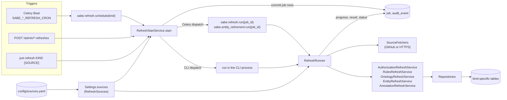
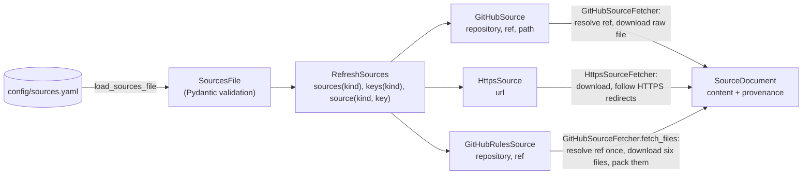
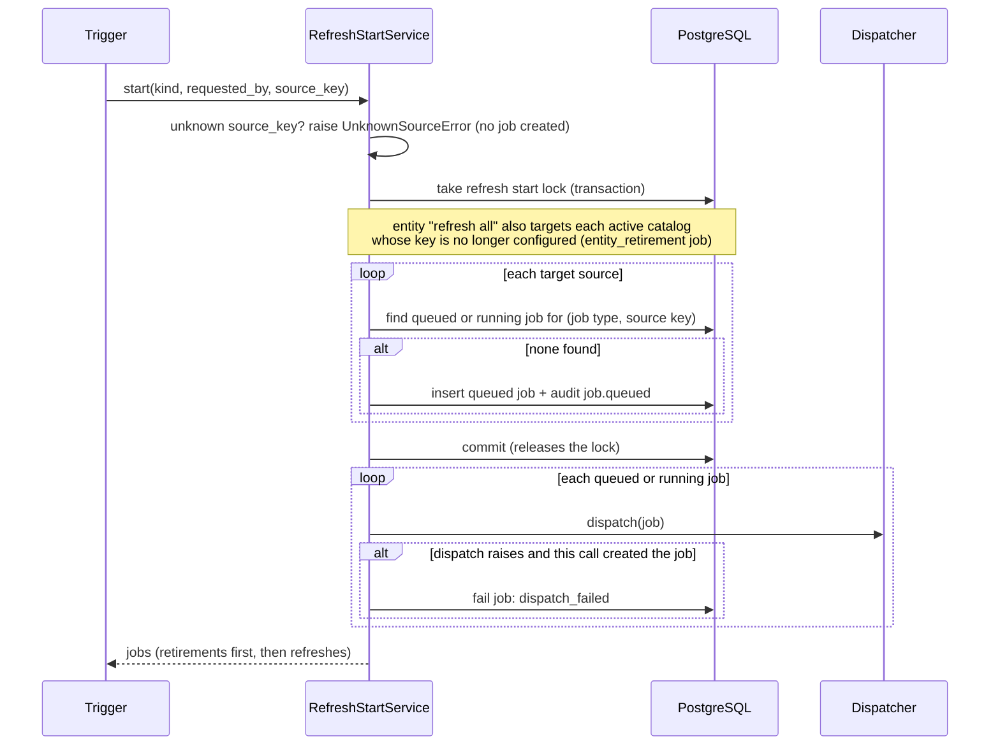
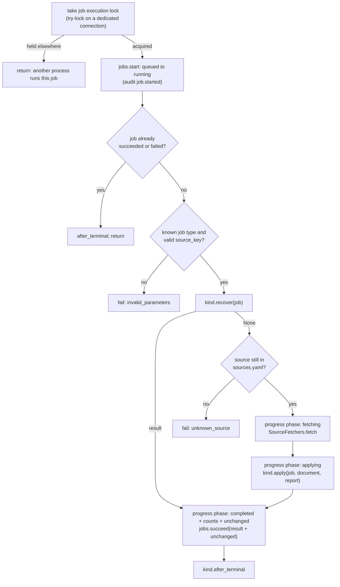
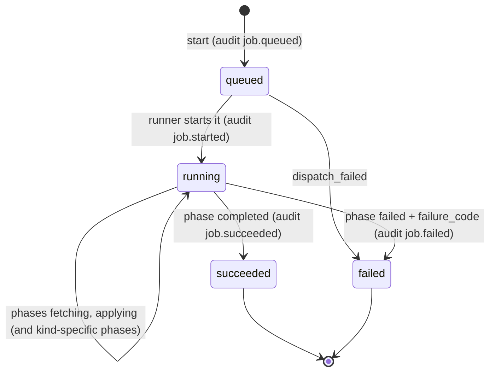

# Refresh infrastructure guide

This guide is for developers changing or debugging reference data refreshes.
`ARCHITECTURE.md` describes the design at a high level, and docstrings describe
each piece. This guide connects the two. It follows a refresh from the moment
something starts it, through the job that runs it, to the rows it writes in
PostgreSQL.

SABE refreshes five kinds of reference data:

| Kind | Source format | Configured in `config/sources.yaml` | Source keys |
|---|---|---|---|
| `authorization` | go-site `users.yaml` | `authorization` (one entry) | always `go-site` |
| `rules` | six go-site metadata files read at one commit | `rules` (one entry: `repository` and `ref`) | always `go-site` |
| `ontology` | OBO | `ontologies` | ontology keys, such as `go` |
| `entity` | GPI 2.0 | `entities` | any key matching `^[a-z0-9][a-z0-9_-]*$` |
| `annotation` | GPAD 2.0 | `annotations` (each entry names the `group` it replaces) | any key matching `^[a-z0-9][a-z0-9_-]*$` |

The annotation kind has two job types, `annotation_refresh` and
`annotation_cutover`, both served by `AnnotationRefreshService`. A cutover is a
final replacement that moves the group to SABE management. It starts only from
the admin API, through `RefreshStartService.start_cutover`.

## The whole picture

Every refresh, however it starts, goes through the same two services:
`RefreshStartService` creates jobs, and `RefreshRunner` runs them. The runner
handles the steps every kind shares and calls the kind's refresh service for the
steps that differ. Each refresh service implements the `RefreshKind` protocol.

Two rules shape everything else:

- **Jobs store only a source key.** A job's parameters are always
  `{"source_key": "<key>"}`. The runner looks the source up in the sources file
  when the job runs, not when it was created. A source removed from the file
  before its job runs fails with `unknown_source` and is never fetched.
- **Everything is safe to repeat.** Celery can deliver a task message more than
  once. A start can find a job already queued. A job can run again after its
  worker stopped partway. Each step checks what is already committed before
  doing new work.

## Inputs: `config/sources.yaml`

`Settings` reads the file when it is constructed (`SABE_SOURCES_FILE`, default
`config/sources.yaml`). An invalid file stops the API, worker, scheduler, and CLI
at startup. The models live in `refresh/sources.py`:

A `SourceDocument` carries the downloaded bytes and their provenance:
`source_type`, `source_locator` (`github:<repository>:<path>`, `github:<repository>`
for the rules source, or the URL), `source_revision` (the resolved commit, or `None`
for HTTPS), `source_checksum` (SHA-256 of the downloaded bytes), and `fetched_at`.
Every kind stores these fields on the record it creates, and every kind uses them to
decide whether a document is already active. The rules source is six files read at
one commit; `pack_source_files` combines them into one document's content, so they
share one provenance and one checksum, and the rules service separates them again
with `unpack_source_files`.

## Starting a refresh

| Trigger | Entry point | `requested_by` | How jobs are dispatched |
|---|---|---|---|
| Schedule | Beat entries `authorization-refresh`, `rules-refresh`, `ontology-refresh`, `entity-refresh`, `annotation-refresh` call `sabe.refresh.schedule(kind)` in `workers/tasks.py` | `scheduler` | Celery (`tasks.dispatch_refresh_job`) |
| API | `api/routes/admin.py` | the caller's actor ID | Celery (`tasks.dispatch_refresh_job`) |
| CLI | `cli/refresh.py` (`just refresh`) | `cli` | in the CLI process, one job at a time |

All three triggers call `RefreshStartService.start(kind, requested_by=..., source_key=...)`.
A `source_key` refreshes one source; `None` refreshes every configured source of the
kind. The authorization and rules routes, and the CLI for those kinds, never pass a key,
because each kind has only one source. For annotations, "refresh all" leaves out groups
that are SABE-managed, and naming a SABE-managed group's source raises
`GroupSabeManagedError` (`group_sabe_managed`, HTTP 409) before any job is created.
Cutovers use a separate entry point, `RefreshStartService.start_cutover`, which the
`POST /admin/annotation-cutovers` route calls. The schedule and CLI never start
cutovers.

Points worth knowing when something looks wrong:

- **Reuse.** A start never creates a second unfinished job for the same source.
  It returns the existing one and dispatches it again. That is how a job whose
  worker disappeared gets resumed: any later start sends it again.
- **Commit before dispatch.** A worker must be able to read the job it is sent.
- **Dispatch failures.** Only a job created by this call is marked failed
  (`dispatch_failed`). A reused job may already be in the broker, so it is left
  as it is.
- **Routing.** `tasks.dispatch_refresh_job` sends `entity_retirement` jobs to
  `sabe.entity_retirement.run` and every other job to `sabe.refresh.run`. Celery
  messages carry only the job ID.

## Running a job

`RefreshRunner.run(job_id)` in `refresh/runner.py` is the same for every kind.
The Celery task `sabe.refresh.run` and the CLI both call it.

Any exception raised after the job has started is classified:

| Error | Outcome |
|---|---|
| `SourceError` (from fetching or decoding) | job fails with its code: `timeout`, `http_status`, `source_error`, `invalid_gzip`, `invalid_utf8` |
| `UnknownSourceError` | job fails with `unknown_source` |
| `TerminalRefreshError` (raised by a kind) | job fails with its code and `failure_details` |
| `RetryableRefreshError` (such as a busy lock) | logged at INFO and re-raised; the job stays `running` with its committed work |
| anything else | re-raised; the job stays `running` with its committed work |

The runner records a failed job through `JobService.fail_refresh`. In one
transaction it sets the status, stores
`{"phase": "failed", "failure_code": ..., "failure_details"?: ...}` as progress,
writes the `job.failed` audit event, and calls the service's `discard_staging`.

A re-raised error means "try again later". Celery's wrapper
(`_retry_safely` in `workers/tasks.py`) logs only the exception type and retries
after 30 seconds. The CLI logs it and reports the job as still `running`. The
next start for that source reuses the job and runs it again, and `recover` picks
up whatever the earlier attempt committed.

### The job record over time

Kinds may report their own phases inside `applying`. Entity refreshes report
`staging` and then `publishing`. When nothing was applied because the document
was already active, `apply` returns an outcome with `unchanged` set. The runner
alone records it: completed progress and the job result of every refresh job
include `"unchanged"` (`true` or `false`). Retirement jobs record neither.

## What each kind does

Each kind's refresh service implements the `RefreshKind` protocol in
`refresh/runner.py`. Read the rows below side by side: the steps are the same,
and only their contents differ. Recognizing an already active document is part
of `apply`.

| Step | Authorization (`AuthorizationRefreshService`) | Rules (`RulesRefreshService`) | Ontology (`OntologyRefreshService`) | Entity (`EntityRefreshService`) | Annotation (`AnnotationRefreshService`) |
|---|---|---|---|---|---|
| `recover` | nothing to recover; the replacement is one transaction, and `apply` recognizes it as unchanged | this job's `rules_snapshot` row, if retention has kept it | stored `refresh_result` on this job's `ontology_metadata` row | stored publication result, or committed staging, which it publishes without fetching | stored publication result from this job's `annotation_import` row; unpublished staging is discarded and redone, not resumed |
| unchanged check (inside `apply`) | most recent `authorization_refresh` row has the same type, locator, revision, and checksum | active `rules_snapshot` row has the same type, locator, and checksum, and already stores the rule data and PMIDs this release parses from the files; the commit is not compared | active `ontology_metadata` row has the same type, locator, revision, and checksum | active `entity_catalog_snapshot` has the same locator and checksum | ordinary refreshes only (a cutover never skips): the group is `gpad_imported`, its last published import has the same checksum and schema package version, and the group has no local changes |
| `apply` | decode UTF-8, validate `users.yaml`, replace users and grants | unpack, decode, and validate all six files, check unchanged, then take the rules refresh lock, check unchanged again, store and activate the snapshot, and delete snapshots older than the one it replaced | take the ontology lock, check unchanged again, parse OBO, stage, activate | decode gzip and UTF-8, parse GPI, stage, publish | try the group lock, refuse a SABE-managed group, decode gzip and UTF-8, parse GPAD, stage, publish (replacing the group's annotations) |
| Tables written | `sabe_user`, `sabe_group`, `authorization_assignment`, `authorization_refresh` | `rules_snapshot`, `retracted_publication` | `ontology_metadata`, `ontology_term`, `ontology_alt_id`, `ontology_closure` | `entity_catalog_snapshot`, `entity_staging_record`, `entity_membership`, `entity_source_record` | `annotation_staging` (and its multivalued and duplicate-reference child tables), `annotation_import`, `group_annotation_management`; on publication, the group's `annotation` rows and dependents are deleted and replaced |
| Audit action | `authorization.refreshed` | `rules.refreshed` | `ontology.refreshed` | `entity.refreshed` (`entity.retired` for retirement) | `annotation_refresh.published` or `annotation_cutover.published` |
| Kind-specific failure codes | `invalid_document` | `invalid_document` | `invalid_document`, `candidate_conflict` | `header`, `row_validation`, `catalog_collision`, `candidate_conflict` | `header`, `no_valid_annotations`, `cutover_rejected`, `group_sabe_managed` |
| `discard_staging` (on failure) | none | none | none | deletes the job's staging rows | deletes the job's staging rows and unpublished `annotation_import` row |
| `after_terminal` | nothing | nothing | prune old snapshot data | nothing | nothing |

Some details that matter when debugging:

- **Authorization.** `AuthRepository.replace_authorizations` takes the
  authorization refresh lock and checks the most recent refresh again inside the
  same transaction. Two concurrent refreshes of the same document therefore apply
  it once. A redelivered job fetches again, finds its own committed refresh
  as unchanged, and succeeds with `"unchanged": true`.
- **Rules.** The fetched document packs six go-site files read at one commit, so a
  snapshot never mixes revisions. `apply` validates all six before it opens the
  activation transaction, and failure details locate each issue by file path.
  `RulesRepository.activate` takes the rules refresh lock and checks the active
  snapshot again, so two concurrent refreshes of the same files store one snapshot.
  The unchanged check compares the files, not the commit, because most go-site
  commits change none of them. It also compares the stored rule data and PMIDs with
  what this release parses, so a SABE upgrade that reads the files differently
  stores them again on its first refresh. Activation keeps the snapshot it replaces,
  so a reader that resolved it moments earlier can finish, and deletes older
  snapshots with their retracted publications. The result's
  `unrecognized_extension_namespaces`, with one warning each, lists
  `extensions-constraints.yaml` namespaces that are neither a configured ontology
  prefix nor a `db-xrefs.yaml` database. It is computed against the current
  configuration on every run, including unchanged ones.
- **Ontology.** Staging and activation happen while the job holds the
  per-ontology lock (`ontology_refresh_lock`). If another process holds it,
  `apply` raises `OntologyRefreshBusyError`, a `RetryableRefreshError`, so the
  job stays `running` and the run is retried. Pruning runs after every finished
  ontology job: through `sabe.ontology.prune` under Celery, or directly in the
  CLI process, where a busy lock or a pruning error is logged and skipped.
  Removing an ontology from `config/sources.yaml` stops its prefix from being
  checked once processes reload their configuration; its snapshots are not retired
  and stay stored.
- **Entity.** Staging and publication are separate transactions. If a worker
  stops between them, `recover` publishes the committed staging on the next run.
  Publication holds the per-source entity catalog lock. A "refresh all" request
  also creates an `entity_retirement` job for every active catalog whose source
  key is no longer configured. `RefreshRunner.run_retirement` runs it, and it does
  nothing if the key has been added back.

- **Annotation.** Publication replaces the target group's annotations, change
  sets, comments, and related audit events, and cannot be undone. Staging and
  publication are separate transactions. Publication takes the exclusive global
  annotation-write lock, so annotation writes wait until it commits. Rows that
  cannot be read or fail structural validation are rejected and reported; an
  ordinary refresh publishes the rest, and a cutover fails on any rejection.

## Term replacement jobs

A `term_replacement` job replaces obsolete terms and alternative IDs in active
annotations (see `docs/annotation-validation.md`). It is not a refresh kind: it
fetches nothing, and `TermReplacementService` runs it instead of `RefreshRunner`.

- **Triggers.** Every ontology activation queues a job for all groups
  (parameters `{}`), and every annotation publication queues one for that group
  (`{"group_key": ...}`). The job is created in the activation's or publication's
  transaction, with the triggering job's requester, and is sent to
  `sabe.term_replacement.run` after that transaction commits.
- **Coalescing.** A trigger joins the scope's queued job if there is one; a running
  job is never joined, because it may have read its facts before the change. If
  sending a job fails, it stays queued, and the next trigger for its scope joins it
  and sends it again.
- **Running.** The job holds its own lock and its scope's lock; if another job of
  the same scope is running, the task is retried and the job stays queued. It reads
  active annotations in `annotation_id` order, 500 at a time, without locks, and
  writes each changed annotation in its own transaction through the normal update
  path. The result counts annotations scanned, replaced, skipped because of issues,
  and skipped as stale, and lists the snapshot IDs read.
- **Failures.** `invalid_parameters` for parameters other than `{}` or
  `{"group_key": ...}`, and `reference_data_unavailable` when a configured ontology
  or the go-site rule data has no active snapshot.
- **The CLI.** `just refresh` runs the replacement jobs its refreshes queued once,
  in its own process, after the refresh jobs finish, and prints a line for each.

## QC report jobs

An `annotation_qc_report` job validates every active annotation in its scope and stores
findings and counts (see `docs/annotation-validation.md`). Like term replacement, it is
not a refresh kind: `QcReportRunner` runs it instead of `RefreshRunner`.

- **Triggers.** `POST /reports/annotation-qc` (admin role) and the Beat entry
  `annotation-qc-report`, which calls `sabe.qc_report.schedule` on `SABE_QC_REPORT_CRON`
  to start an all-groups report. Both join the scope's queued report if there is one,
  and send the job to `sabe.qc_report.run` after it commits. If sending fails, the job
  stays queued until the next start of its scope.
- **Running.** The job holds its own lock and its scope's lock; if another report of the
  same scope is running, the task is retried and the job stays queued. It first deletes
  rows left by an earlier attempt and checks that reference data is available. It then
  reads active annotations in `annotation_id` order, 500 at a time, without locks, and
  commits each batch's findings and counts. Reference data is resolved per batch, and
  the result lists every distinct set used. Marking the job succeeded and deleting the
  findings of earlier reports of its scope commit together. Reports of a scope are
  ordered by completion time, then job ID.
- **Failures.** `invalid_parameters`, and `reference_data_unavailable`. A failed report
  keeps no findings or counts.
- **The CLI.** `just refresh` does not run QC reports.

## Locks

| Lock | Kind of lock | Held by | Prevents |
|---|---|---|---|
| Refresh start lock | transaction advisory lock | `RefreshStartService.start` | two starts both creating a job for the same source |
| Job execution lock | session try-lock, one per job | `RefreshRunner.run`, `run_retirement`, `TermReplacementService.run`, `QcReportRunner.run` | two processes running one job after a duplicate delivery |
| Authorization refresh lock | transaction advisory lock | `replace_authorizations` | concurrent authorization replacements |
| Rules refresh lock | transaction advisory lock | `RulesRepository.activate` | concurrent activations, so refreshes of the same files store one snapshot |
| Ontology refresh lock | session try-lock, one per ontology | ontology `apply` and `prune` | out-of-order activation, and pruning a snapshot that is being activated |
| Entity catalog lock | transaction advisory lock, one per source | entity publish and retire | concurrent changes to one source's active catalog |
| Annotation system-update lock | exclusive global annotation-write lock | annotation publication | ordinary annotation writes during group replacement |
| Annotation group lock (`annotation_group_lock`) | session try-lock, one per group | annotation `apply`, after the document is fetched and found changed | two GPAD jobs for one group staging or publishing at once |
| Term replacement start lock | transaction advisory lock | `queue_term_replacement` | two triggers both creating a queued job |
| Term replacement scope lock | session try-lock, one per scope | `TermReplacementService.run` | two jobs of one scope running at once |
| QC report start lock | transaction advisory lock | `queue_qc_report` | two starts both creating a queued report |
| QC report scope lock | session try-lock, one per scope | `QcReportRunner.run` | two reports of one scope running at once |

The try-locks never wait. A process that cannot take one either returns (job
lock) or raises so the task is retried later: the ontology lock, the annotation group
lock (`AnnotationRefreshBusyError`), and the term replacement and QC report scope
locks (`TermReplacementBusyError` and `QcReportBusyError`).

## Where to start

| Symptom or task | Look at |
|---|---|
| A job stays `running` | worker logs for `Worker task unavailable` (Celery retries) or `Refresh job stopped before finishing` (CLI); for a refresh, start the same refresh again to dispatch and resume it. A running term replacement or QC report job resumes only when Celery redelivers or retries its task; a QC report then starts again from empty rows |
| A term replacement or QC report job stays `queued` | worker logs for `Term replacement dispatch failed` or `QC report dispatch failed` (the next trigger for its scope sends it again), or another job of its scope holding the scope lock (the task retries every 30 seconds) |
| A job failed | its `progress.failure_code` and `failure_details` through `GET /admin/jobs/{job_id}`; the table of classified errors above |
| `unknown_source` | the job's `source_key` against `config/sources.yaml` as loaded by the running process (settings are cached per process) |
| A refresh did nothing | completed progress with `"unchanged": true` (also in the job result): the source document is already active |
| A scheduled refresh never ran | `workers/celery_app.py` Beat entries and the `SABE_*_REFRESH_CRON` settings |
| Adding a source to an existing kind | `config/sources.yaml` only; no code change |
| Adding a source type | `refresh/sources.py` (model) and `refresh/fetchers.py` (fetcher) |
| Adding a refresh kind | a refresh service implementing `RefreshKind` in `services/`, its job type and audit action in `domain/`, wiring in `workers/runtime.py`, a section in `config/sources.yaml`, a Beat entry, and an admin route |

## Tests

| Area | Tests |
|---|---|
| Sources file and fetchers | `tests/unit/test_sources_file.py`, `tests/unit/test_source_fetchers.py` |
| go-site rule files | `tests/unit/test_go_site_rule_files.py`, `tests/unit/test_rule_data.py` |
| Shared lifecycle, run for every kind | `tests/integration/test_refresh_runner.py` (the `CASES` table) |
| Starting, reuse, dispatch, and concurrent starts | `tests/integration/test_refresh_start_service.py` |
| Kind-specific behavior | `tests/integration/test_*_refresh_jobs.py`, `test_*_refresh_service.py`, `test_*_refresh_concurrency.py`, `test_entity_catalog_retirement.py`, `test_users_yaml_sync.py` |
| Entry points | `tests/integration/test_admin_api.py`, `tests/integration/test_refresh_cli.py`, `tests/unit/test_worker_task_safety.py`, `tests/unit/test_celery_app.py` |

`tests/integration/refresh_helpers.py` provides `FakeFetchers`, which returns
fixed documents instead of using the network, and `build_runner`, which builds
the production runner and kinds around them.
